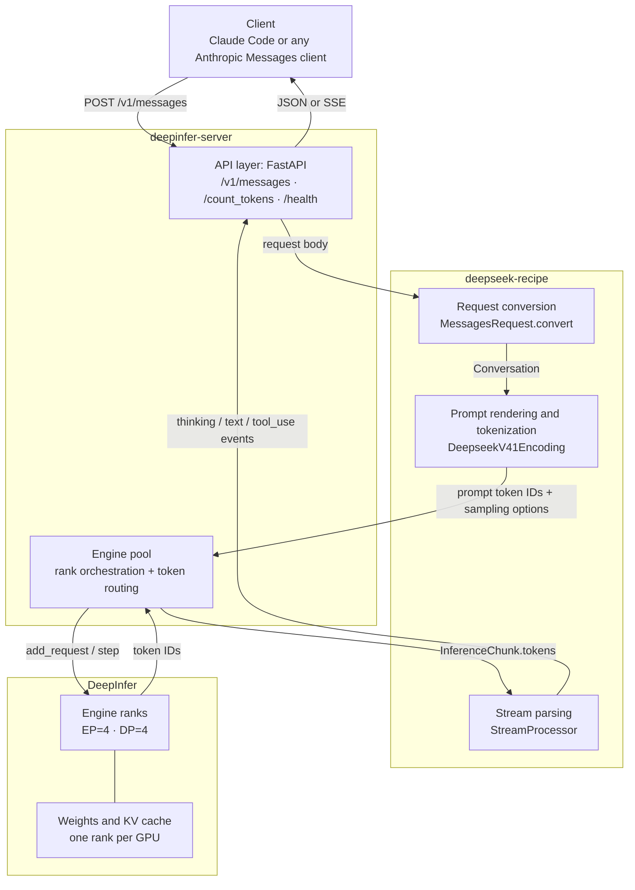

# DeepInfer Server

An Anthropic Messages API server backed by a DeepInfer inference engine. The
server handles request conversion, prompt rendering, streaming, tool calls, and
usage accounting, and exposes the result over HTTP. Any Anthropic-compatible
client can use it; Claude Code is included as a worked example.

## Layout

- `server.py` - FastAPI gateway: `/v1/messages` (JSON and SSE),
  `/v1/messages/count_tokens`, `/v1/models`, `/health`.
- `engine_pool.py` - one DeepInfer engine process per GPU, driven in lockstep;
  expert-parallel collectives stay aligned even when only some ranks have work.
- `start.sh` - loads the DeepInfer environment and starts uvicorn.
- `smoke_test.sh` - non-stream, stream, tool-call, and token-count checks.
- `examples/` - client integrations; see `examples/claude-code/`.

## Requirements

- A built DeepInfer checkout and virtualenv with its NVIDIA dependencies.
- A local DeepSeek-V4.1-Flash checkpoint.
- Four GPUs in one NVSwitch domain; expert parallelism is set to four by default.
- `deepseek-recipe` 0.2.0 or newer (see `requirements.txt`).

## Start

```bash
export DEEPINFER_ENV=/path/to/venv/bin/activate
export DEEPINFER_REPO=/path/to/DeepInfer
export GATEWAY_MODEL=/path/to/DeepSeek-V4.1-Flash-1017
export GATEWAY_GPUS=0,1,2,3
./start.sh
```

Model loading takes a few minutes. `/health` reports `"ready": true` once all
ranks are up. Other knobs: `PORT` (default `8000`), `HOST`, `MASTER_PORT`,
`GATEWAY_MAX_MODEL_LEN` (default `65536`), `GATEWAY_EP`, `GATEWAY_DP`,
`GATEWAY_GPU_MEMORY_UTILIZATION`, `GATEWAY_THINKING`, `GATEWAY_API_KEY`.

Keep the four GPU indices on one NUMA/NIC rail set. A mixed set can make DeepEP
pick mismatched RDMA devices and fail during startup.

## API

- `POST /v1/messages` - Anthropic Messages, JSON or SSE with `"stream": true`.
- `POST /v1/messages/count_tokens` - prompt token count.
- `GET /v1/models` - served model id.
- `GET /health` - readiness, GPU list, and engine errors.

## Architecture



- **DeepInfer** runs the model: weights, KV cache, expert/data parallelism,
  sampling, and speculative decoding.
- **deepseek-recipe** owns the format: protocol conversion, DeepSeek prompt
  rendering, tokenization, and parsing model output into Anthropic events.
- **deepinfer-server** owns transport and scheduling: HTTP/SSE, rank
  orchestration, request routing, and readiness reporting.

See [docs/architecture.md](docs/architecture.md) for the request sequence and
the full responsibilities table.

## Examples

- [Claude Code](examples/claude-code/README.md) - point Claude Code at the
  server with `ANTHROPIC_BASE_URL`.

## Notes

- The server speaks the Anthropic Messages API only; OpenAI
  `/v1/chat/completions` and `/v1/responses` are not implemented.
- Text input only for now; image blocks return HTTP 400.
- DeepInfer has no prefix cache, so each turn re-prefills its full context.
- The first request on each rank pays kernel JIT cost; later turns are faster.
- Verified with Claude Code 2.1.304, including streamed tool calls and a
  multi-turn write/read file task.

## License

Copyright 2026 Yi Liu. Licensed under the [Apache License 2.0](LICENSE).
