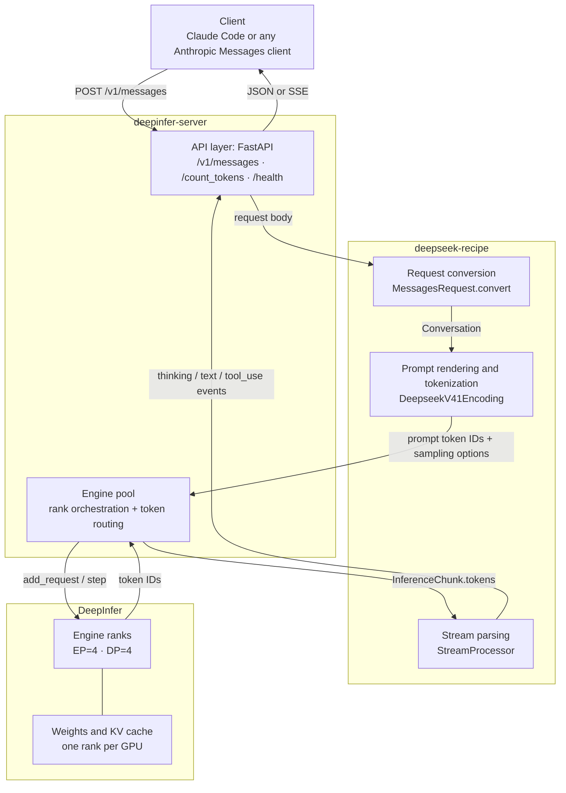
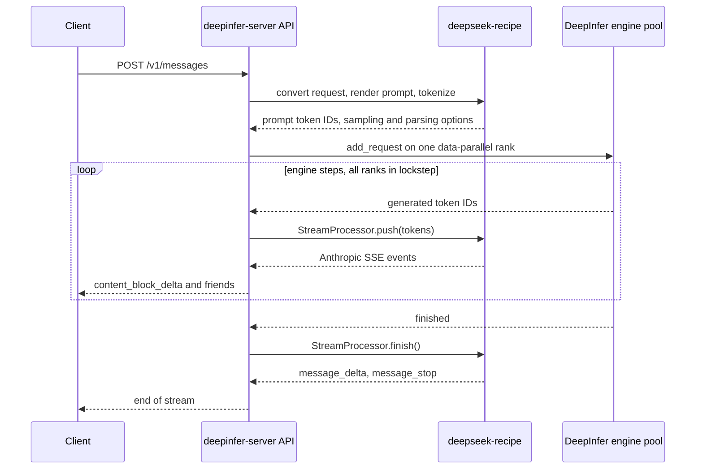

# Architecture

Three pieces cooperate: **DeepInfer** runs the model, **deepseek-recipe** owns
the DeepSeek request/response format, and **deepinfer-server** connects them to
an HTTP client.

## Component view

## Request flow

## Responsibilities

| Component | Owns | Does not do |
| --- | --- | --- |
| DeepInfer | Model execution, weights, KV cache, expert/data parallelism, sampling, speculative decoding | HTTP transport, Anthropic protocol details |
| deepseek-recipe | Messages/Chat/Responses conversion, DeepSeek prompt rendering, tokenization, streaming output parsing, tool calls, thinking blocks | Model inference, request routing, HTTP transport |
| deepinfer-server | HTTP endpoints, SSE framing, rank orchestration, request-to-rank routing, readiness and error reporting | Model kernels, prompt format details |

## Why the split

- deepseek-recipe has no inference backend and no HTTP layer; it turns protocol
  objects into DeepSeek prompts and model output back into protocol objects.
- DeepInfer has no client API; it exposes request-level engine calls
  (`add_request`, `step`, `abort_request`) but no transport.
- deepinfer-server is the thin layer that adds transport, multi-rank scheduling,
  and streaming, while leaving model and format concerns to the other two.

## GPU layout

The engine pool starts one process per GPU. Each process owns one DeepInfer
engine rank and one visible GPU, all ranks join one expert-parallel group, and
the pool calls `step` on every rank for each scheduling round. Ranks without
requests execute a placeholder step so expert-parallel collectives always have
all participants.
